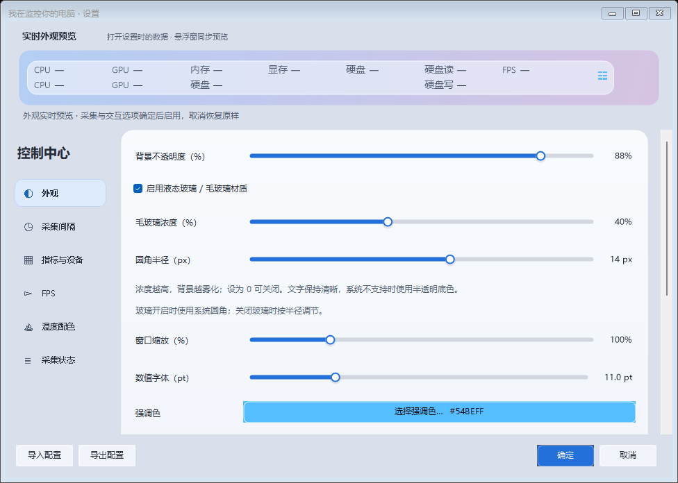
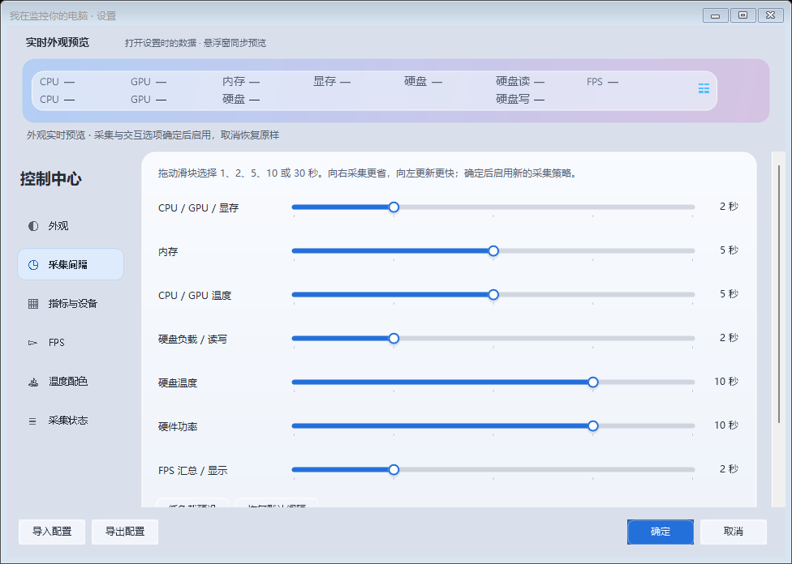
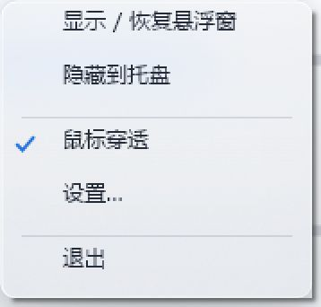

# QingMonitor

**我在监控你的电脑**

让性能数据，安静待在桌面一角。

面向 Windows 的独立性能悬浮窗 · 两行读数 · 玻璃外观 · 本地运行

**[下载最新版](https://github.com/NINETEEN1120/QingMonitor/releases/latest)** · **[快速开始](#快速开始)** · **[开发文档](docs/DEVELOPMENT.md)** · **[未来计划](docs/ROADMAP.md)**

[简体中文](README.md) · [English](docs/README.en.md)

QingMonitor 把 CPU、GPU、内存、显存、硬盘和 FPS 放进桌面上的一条小窗。百分比与温度分成两排，选中的功率、硬盘读写和 FPS 也能直接显示；指标增加时向右扩展，尽量保持两行。

“我在监控你的电脑”指的是**本机系统性能监测**。性能数据留在本机，不上传云端，不提供远程控制。它是独立桌面应用，无需 Xbox Game Bar。

## 看得到，也调得顺手

| 两行数据，按需展开 | 玻璃外观，实时预览 | 采集节奏，自己决定 |
| --- | --- | --- |
| 日常看数值，需要时展开趋势；折叠后继续更新读数，停止图表历史积累与绘制。 | 调整底色、透明度、磨砂感、圆角、字号和尺寸；外观变化同步预览，取消恢复，确定后保存。 | 7 组采集间隔，可选 1 / 2 / 5 / 10 / 30 秒；FPS 由独立开关控制。 |

<table>
  <tr>
    <td width="50%"></td>
    <td width="50%"></td>
  </tr>
  <tr>
    <td align="center">外观设置 · 滑块调整与实时预览</td>
    <td align="center">采集间隔 · 各组独立设置</td>
  </tr>
</table>

查看托盘菜单

上方横幅为设计示意，数字均为示例数据。界面截图来自 0.1.11 的界面验证环境；空读数不代表硬件能力，实际传感器与外观取决于设备、权限和 Windows 设置。

## 功能

- **按需显示指标**：CPU / GPU 使用率与温度、内存 / 显存、硬盘负载 / 温度 / 读写、可用的硬件功率及 FPS；支持选择 GPU 和多块物理硬盘。
- **两行横条与趋势图**：百分比、温度分排；支持拖动、边缘调宽高、四角等比例缩放，展开后查看所选指标的趋势。
- **可调玻璃外观**：背景不透明度、磨砂浓度、圆角、字体与强调色；系统不支持原生材质时回退到半透明底色。
- **设置实时预览**：18 个数值滑块；外观即时预览，取消恢复原样，确定后保存。采集策略、FPS 与交互开关在确定后生效。
- **分组采集**：使用率、内存、温度、硬盘负载 / 读写、硬盘温度、功率、FPS 显示分别配置；共享数据源合并读取。
- **独立 FPS**：默认关闭；手动开启即启动 PresentMon 连续帧事件采集，可跟随前台应用或固定进程，无需等待识别出游戏。
- **桌面操作**：置顶、位置锁定、托盘隐藏 / 恢复、鼠标穿透、配置导入 / 导出，以及可调温度分级配色。

## 快速开始

### 运行条件

| 项目 | 当前要求与说明 |
| --- | --- |
| 操作系统 | 首要目标为 **Windows 11 x64**；Windows 10 兼容性尚待实际验证。 |
| 运行库 | **.NET Framework 4.8**。运行成品无需安装 Codex、PowerShell 或开发工具。 |
| 温度传感器 | 支持情况取决于硬件、驱动和权限；CPU / 硬盘温度通常需要管理员权限及 PawnIO。 |
| 游戏显示 | 优先尝试窗口化或无边框全屏；真正独占全屏下的可见性尚未验证。 |

### 下载安装包

1. 打开 **[Releases](https://github.com/NINETEEN1120/QingMonitor/releases/latest)**，选择离线安装包。
2. 按安装器提示选择目录；需要温度支持时查看 PawnIO 选项及权限说明。
3. 启动 `QingMonitor.exe`，进入设置选择指标、设备与外观。

### 使用便携包

1. 从同一发布页下载便携 ZIP，**完整解压**到有写入权限的目录。
2. 保留附带的依赖、`licenses` 和驱动说明，运行 `QingMonitor.exe`。
3. 普通性能读数可先尝试直接运行；温度不可用时再按随包说明检查权限及驱动。

配置默认保存在 `%LOCALAPPDATA%\QingMonitor`。可从设置导入 / 导出配置。便携包表示解压运行；默认配置仍放在当前用户的数据目录。

> PawnIO 是可选温度支持组件。随包提供的是未经修改的官方安装器，适用其原有许可；它不属于项目自身的 MIT 代码。删除或退出 QingMonitor 不会卸载系统共享的 PawnIO 驱动。

## 常用操作

| 想做什么 | 操作 |
| --- | --- |
| 移动悬浮窗 | 按住数值区域拖动。 |
| 改变大小 | 拖动边缘调整宽高；拖动四角等比例缩放。锁定或穿透时禁用调整。 |
| 查看趋势 | 使用展开 / 折叠按钮，并选择要查看的指标。 |
| 调整外观与采样 | 打开设置；拖动滑块，完成后选择“确定”。 |
| 开启 / 关闭 FPS | 使用独立 FPS 开关；折叠或隐藏窗口不会替你关闭它。 |
| 开启 / 解除鼠标穿透 | 通过托盘菜单或设置切换；悬浮窗本身不放穿透按钮。 |
| 找回窗口 | 在托盘菜单选择“显示 / 恢复悬浮窗”。 |
| 结束监控 | 在托盘菜单选择“退出”。 |

隐藏到托盘会暂停普通采集和图表工作；FPS 保持其独立开关的状态。FPS 的“间隔”控制汇总 / 显示，开启期间帧事件仍连续采集。

## 使用边界与常见问题

**为什么有些值显示 `—`？** 代表当前没有有效数据，不会用 `0°C`、`0 W` 或桌面刷新率代替。先检查“采集状态”、所选设备、权限和相应驱动；并非每台电脑都会提供全部传感器。

**“毛玻璃浓度”会改变系统模糊半径吗？** 它调节磨砂遮蔽感与底色，原生模糊半径由 Windows 管理。启用原生玻璃时，圆角也可能由系统管理。

**名字里的“监控”会收集隐私吗？** 当前应用不含云端上传、账号登录或远程访问功能。配置、采集状态和诊断日志在本机保存。手动访问项目或驱动官网时，会由浏览器打开相应网页；提交 Issue 前请检查日志中的进程名和本机路径。

**会影响游戏性能吗？** 开销取决于硬件、采集间隔、显示项目与 FPS 状态。项目采用分组采集和按需绘制来减少工作，但当前没有跨硬件的占用或帧率保证。真实游戏 FPS、长期负载、混合 DPI 跨屏、独占全屏和其他电脑仍需继续验收。

## 开发与参与

应用使用 **C# · WinForms · .NET Framework 4.8**，传感器读取基于 LibreHardwareMonitor，FPS 基于 PresentMon。

- [开发文档](docs/DEVELOPMENT.md)：目录结构、离线依赖、构建与检查。
- [未来计划](docs/ROADMAP.md)：兼容性、实际场景验收与后续方向。
- [贡献指南](CONTRIBUTING.md)：提交问题、复现信息与改动流程。
- [提交问题](https://github.com/NINETEEN1120/QingMonitor/issues/new)：附上版本、Windows 版本和最小复现步骤；不要上传个人配置或未经检查的完整日志。

欢迎贡献兼容性反馈、文档改进与可复现的修复。尤其欢迎不同 GPU、多硬盘、混合 DPI 与真实游戏场景的验证结果。

## 许可与致谢

QingMonitor 自行编写的代码采用 [MIT License](LICENSE)。第三方组件保留各自的许可证，项目 MIT 许可不覆盖第三方库、模块或官方驱动安装器；详见 [第三方声明](docs/THIRD_PARTY_NOTICES.md)，分发时请保留随包声明与 `licenses` 目录。

感谢 [LibreHardwareMonitor](https://github.com/LibreHardwareMonitor/LibreHardwareMonitor)、[PresentMon](https://github.com/GameTechDev/PresentMon) 和 [PawnIO](https://pawnio.eu/) 等上游项目及贡献者。
