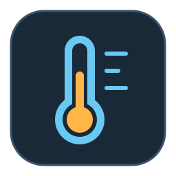
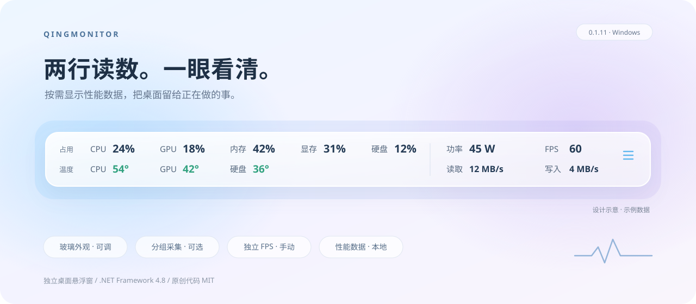

# QingMonitor

**Your performance data, quietly in a corner of your desktop.**

A standalone Windows performance overlay with two-row readings, a glass appearance, and local data.

**[Download](https://github.com/NINETEEN1120/QingMonitor/releases/latest)** · **[简体中文](../README.md)** · **[Roadmap](ROADMAP.md)**

QingMonitor displays CPU, GPU, memory, VRAM, disk metrics, temperatures, available power readings, and optional FPS in a compact desktop overlay. Its Chinese name, “我在监控你的电脑,” refers to **local system performance monitoring**. Telemetry stays on your computer; the application has no cloud upload, login, or remote-access feature.

## Features

- Two rows for utilization and temperatures, expanding horizontally as metrics are selected. Power, disk I/O, and FPS can also appear directly in the overlay.
- Expandable trend charts. Collapsing stops chart history and drawing while numerical readings continue.
- Adjustable glass material, opacity, corner radius, font, colors, and size. Appearance changes preview live; Cancel restores the previous appearance and OK saves the result.
- Eighteen numerical sliders, including seven sampling groups with 1 / 2 / 5 / 10 / 30-second choices.
- Device selection, multiple physical disks, configurable temperature colors, and configuration import / export.
- Independent, manual FPS capture through PresentMon. Off by default; capture runs continuously while enabled, regardless of whether the window is collapsed or hidden.
- Drag, resize, pin, lock, tray recovery, and mouse click-through controls.

The hero is an illustration with sample data. The screenshots in the [Chinese README](../README.md) show a UI verification environment, not sensor or performance benchmarks.

## Get started

The current target is **Windows 11 x64 with .NET Framework 4.8**. Download the offline installer or portable ZIP from [Releases](https://github.com/NINETEEN1120/QingMonitor/releases/latest). For the portable package, extract the entire archive and run `QingMonitor.exe`; keep its dependencies, notices, and `licenses` directory.

Settings default to `%LOCALAPPDATA%\QingMonitor`. A portable executable does not make its default settings directory portable. Runtime use does not require Codex, PowerShell, or development tools.

CPU and disk temperatures commonly require administrator privileges and the optional PawnIO driver. Hardware support varies; missing readings display `—`. The bundled official PawnIO installer is distributed unchanged under its own terms. Removing QingMonitor does not uninstall a shared system driver.

## Controls and limitations

Drag the readings to move the overlay; drag edges to resize width or height, or corners to scale proportionally. Use the tray menu to restore the window, toggle click-through, open settings, or exit. Hiding pauses ordinary collection and charts; FPS retains its independent state. Its configured interval controls aggregation / display, not intermittent frame capture.

Windowed or borderless fullscreen is the preferred starting point. Windows 10, mixed-DPI displays, true exclusive fullscreen, real-game FPS, long-run overhead, and other PCs still need further validation. No universal sensor, overhead, or game compatibility guarantee is made.

Configuration, collection status, and diagnostic logs are stored locally. Check logs for process names and local paths before sharing them in an issue.

## Development and license

Built with **C#, WinForms, and .NET Framework 4.8**, using LibreHardwareMonitor for sensors and PresentMon for FPS. See the [development guide](DEVELOPMENT.md), [contribution guide](../CONTRIBUTING.md), and [roadmap](ROADMAP.md) for the current workflow. These supporting documents are primarily in Chinese.

Original application code is licensed under [MIT](../LICENSE). Third-party components, modules, and the official driver installer retain their own licenses; see [third-party notices](THIRD_PARTY_NOTICES.md) and preserve them when redistributing.
